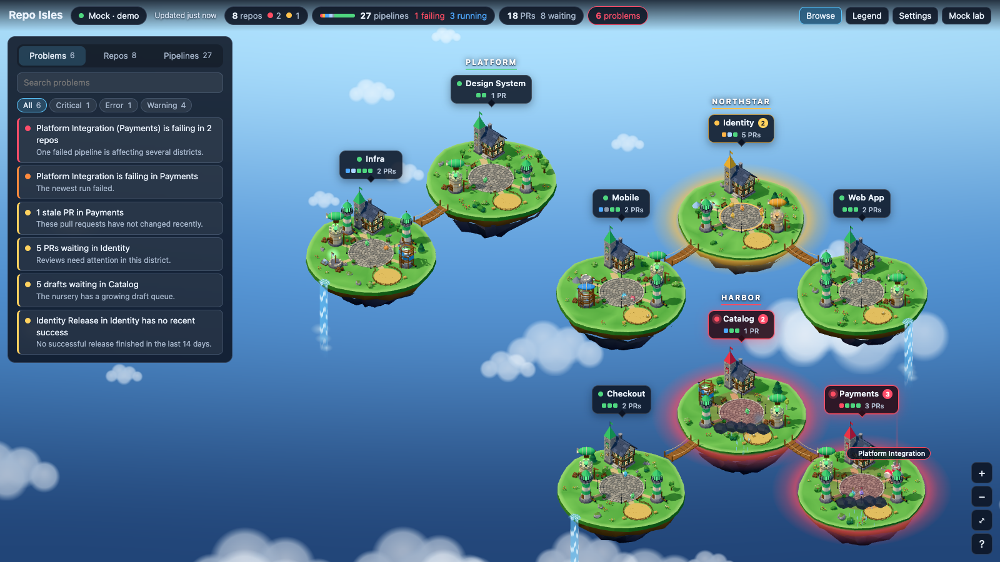

# Repo Isles

Your repositories, pull requests and pipelines as a living world of floating islands.



Every repository you watch becomes an island, and the islands of one project
float together as an archipelago. An island grows with its pipelines: each one
stands on it as a tower, built as far as its latest run got and painted in its
status colour. Open pull requests wander the plaza as little creatures and
drafts wait as eggs in the nursery.

It is built to be read from across the room. An island in trouble glows amber
or red around its shore, a failing pipeline sends up a red beam, and every
island carries a nameplate with one pip per pipeline, so two dozen repositories
and a few hundred pipelines still fit on one screen. Zoom in and the plates
give way to the towers themselves. The top bar adds it all up; the panel on the
left lists every problem, repository and pipeline, and flies the camera to
whichever you pick.

It reads from **GitHub**, **Azure DevOps**, or a built-in **mock** estate, and
it only ever reads.

## Quick start

Requires Node 22.12 or newer.

```bash
git clone https://github.com/mujtaba-zia/Hackyeah.git repo-isles
cd repo-isles
npm install
npm run dev
```

Open <http://localhost:5173>. With no credentials you get the mock estate. Open
**Mock lab** to fail a pipeline, add PRs or new pipelines, or age everything by a
few days and watch the world react. **Settings** switches the mock scenario:
`big-org` shows 24 repositories and 144 pipelines.

## Show your own repositories

Copy `.env.example` to `.env`, fill in one (or both) sources, and restart
`npm run dev`. Credentials stay in the server process: they are never sent to
the browser, logged, or written anywhere else.

### GitHub

```dotenv
PROVIDER=github
GITHUB_TOKEN=github_pat_...
GITHUB_OWNER=your-user-or-org          # every repo it owns
GITHUB_REPOS=octo-org/api,octo-org/web # and/or specific repos
```

Use a fine-grained token with read-only access to *Metadata*, *Contents*,
*Pull requests*, *Actions* and *Commit statuses*, or a classic token with
`repo`. Private repositories show up when `GITHUB_OWNER` is your own account or
an organisation the token can read. For GitHub Enterprise Server set
`GITHUB_API_URL=https://<host>/api/v3`.

### Azure DevOps

```dotenv
PROVIDER=azure
AZURE_DEVOPS_ORG=contoso
AZURE_DEVOPS_PROJECTS=Web,Platform
AZURE_DEVOPS_PAT=...
```

The personal access token needs **Code (Read)** and **Build (Read)**.

Configure both and you can switch between them in **Settings** while the app is
running.

## Tuning

Everything in **Settings** works at runtime: which repositories to watch, how
many to show, thresholds, which rules are on, and the poll interval. To start
with your own defaults, copy `isles.config.example.json` to `isles.config.json`
(gitignored):

| Key | Meaning |
| --- | --- |
| `watch` | Repositories to show: names (`payments`), `project/name`, or ids (`gh:owner/name`). Omit to show everything, up to `maxRepos`. |
| `coverage` | Pipeline name → extra repositories it builds or ships. A pipeline normally only knows its own repo; list the others here and a failure will storm over all of them. |
| `thresholds` | `staleDays`, `waitingHours`, `crowdSize`, `draftPileup`, `failStreakHot`, `releaseStaleDays`. |
| `rules` | Turn any problem rule off. |
| `pollSeconds`, `maxRepos`, `maxPrsPerRepo` | Polling and size limits. `maxRepos` defaults to 24; when the source has more, the Repos list says how many are not shown. |

## Reading the world

| You see | It means |
| --- | --- |
| Island | A watched repository. It is as big as its pipelines need, so a busy repository is a big island. |
| Group of bridged islands under a title | The repositories of one project (GitHub owner, Azure DevOps project). |
| Glow around an island's shore | Amber: something needs attention. Red: something is failing. No glow: all good. The town hall's spire and flag take the same colour. |
| Nameplate | The repository's name, a badge with its number of problems, one pip per pipeline in its status colour, and its open pull requests. |
| Tower | A pipeline or workflow. Lighthouses are CI; keeps with a moored airship are releases. Its painted bands and its light show the status colour. |
| How far a tower is built | Its latest run: foundations while queued, cancelled or never run, scaffolding while running, finished when passing, snapped and fallen when failing. |
| Red beam | A failing pipeline, visible from any distance. |
| Creature in the plaza | An open pull request. Colour shows where it stands: new, waiting for review, changes requested, approved, merge conflict, rejected, stale. |
| Egg in the nursery | A draft pull request. |
| Hourglass / red X above a creature | The PR's checks are running / failing. |
| Outskirts island | Pipelines whose own repository is not shown. It only appears when there are some. |
| Fire | A failing pipeline. |
| Storm | A failing pipeline that several repositories depend on. |
| Crowd | Too many PRs waiting on review. |
| Smoke | Drafts piling up, or a release that has not succeeded in a while. |
| Giant | Three or more repositories in serious trouble at once. |

The **Legend** panel shows the same, with live counts.

## Finding your way around

- **Top bar**: repositories by health, pipelines by status, pull requests
  waiting on someone, and the number of problems. Each opens the matching list.
- **Problems / Repos / Pipelines**: three lists in the left panel. Problems
  filter by severity. Repos are grouped by project, or sorted worst first.
  Pipelines list the most urgent first and filter by status. Type to search any
  of them (`/` jumps to the search box); click a row to fly there.
- **Details**: click an island, tower or creature for its problems, pipelines
  with their recent runs, pull requests, and a link to the real thing.
- **Moving**: drag to pan, scroll or pinch to zoom, double-click to fly to
  something. Arrow keys pan, `+` and `-` zoom, `0` shows everything, `Esc`
  clears the selection. The same controls sit in the bottom right corner.

## Run it for a team

```bash
npm run build
npm start          # one port (8787 by default) serves the page and the live data
```

Put it behind your usual reverse proxy (WebSocket upgrade on `/ws`) and every
viewer sees the same world. State lives in memory. Restarting re-fetches, and
nothing is written to disk.

## Develop

```bash
npm run check      # typecheck + tests
npm run build      # production bundle in dist/
```

### 3D models

Every building, creature, tree and rock is built by Blender Python scripts in
[`art/blender/`](art/blender) and exported as one kit, `public/models/kit.glb`.
The kit is committed, so you only need [Blender](https://www.blender.org/) (tested with 5.2) to
change it:

```bash
npm run models                                  # rebuild public/models/kit.glb
BLENDER=/Applications/Blender.app/Contents/MacOS/Blender npm run models
```

The build checks every model against what the world expects of it (footprint,
height, the materials the app recolours) and fails if one does not fit. Add
`--previews <folder>` after `--out …` in that command to render a PNG of each
model from the game camera's angle, plus a `sheet.png` of all of them.

[`docs/ARCHITECTURE.md`](docs/ARCHITECTURE.md) explains how the pieces fit and
how to add a data source or a new kind of problem.
[`docs/SPEC.md`](docs/SPEC.md) is the full behavioural specification.

## History

This repository previously held *Living City*, an earlier prototype. It is
preserved on the [`living-city`](../../tree/living-city) branch and the
`living-city-final` tag.

## License

[MIT](LICENSE)
