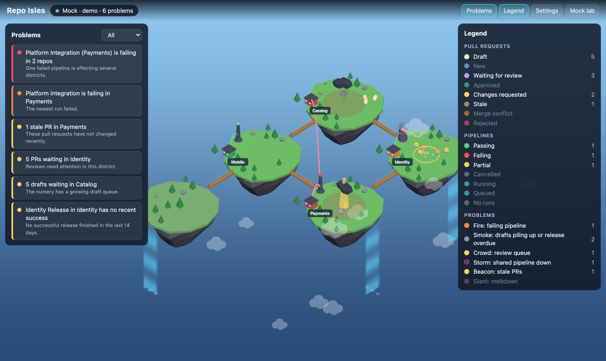

# Repo Isles

Your repositories, pull requests and pipelines as a living world of floating islands.



Every repository you watch becomes an island. Its open pull requests wander the
plaza as little creatures, drafts wait as eggs in the nursery, and each pipeline
stands as a tower with a status light. When something goes wrong you can see it
at a glance. A failing pipeline catches fire. A review queue turns into a crowd.
A pipeline that several repositories depend on throws a storm over all of them.
The Problems list on the left names each issue in plain words; click one and
the camera flies there.

It reads from **GitHub**, **Azure DevOps**, or a built-in **mock** estate, and
it only ever reads.

## Quick start

Requires Node 22.12 or newer.

```bash
git clone https://github.com/mujtaba-zia/Hackyeah.git repo-isles
cd repo-isles
npm install
npm run dev
```

Open <http://localhost:5173>. With no credentials you get the mock estate. Open
**Mock lab** to fail a pipeline, add PRs or new pipelines, or age everything by a
few days and watch the world react.

## Show your own repositories

Copy `.env.example` to `.env`, fill in one (or both) sources, and restart
`npm run dev`. Credentials stay in the server process: they are never sent to
the browser, logged, or written anywhere else.

### GitHub

```dotenv
PROVIDER=github
GITHUB_TOKEN=github_pat_...
GITHUB_OWNER=your-user-or-org          # every repo it owns
GITHUB_REPOS=octo-org/api,octo-org/web # and/or specific repos
```

Use a fine-grained token with read-only access to *Metadata*, *Contents*,
*Pull requests*, *Actions* and *Commit statuses*, or a classic token with
`repo`. Private repositories show up when `GITHUB_OWNER` is your own account or
an organisation the token can read. For GitHub Enterprise Server set
`GITHUB_API_URL=https://<host>/api/v3`.

### Azure DevOps

```dotenv
PROVIDER=azure
AZURE_DEVOPS_ORG=contoso
AZURE_DEVOPS_PROJECTS=Web,Platform
AZURE_DEVOPS_PAT=...
```

The personal access token needs **Code (Read)** and **Build (Read)**.

Configure both and you can switch between them in **Settings** while the app is
running.

## Tuning

Everything in **Settings** works at runtime: which repositories to watch,
thresholds, which rules are on, and the poll interval. To start with your own
defaults, copy `isles.config.example.json` to `isles.config.json` (gitignored):

| Key | Meaning |
| --- | --- |
| `watch` | Repositories to show: names (`payments`), `project/name`, or ids (`gh:owner/name`). Omit to show everything, up to `maxRepos`. |
| `coverage` | Pipeline name → extra repositories it builds or ships. A pipeline normally only knows its own repo; list the others here and a failure will storm over all of them. |
| `thresholds` | `staleDays`, `waitingHours`, `crowdSize`, `draftPileup`, `failStreakHot`, `releaseStaleDays`. |
| `rules` | Turn any problem rule off. |
| `pollSeconds`, `maxRepos`, `maxPrsPerRepo` | Polling and size limits. |

## Reading the world

| You see | It means |
| --- | --- |
| Island | A watched repository. The HQ is tinted by its health. |
| Creature in the plaza | An open pull request. Colour shows where it stands: new, waiting for review, changes requested, approved, merge conflict, rejected, stale. |
| Egg in the nursery | A draft pull request. |
| Hourglass / red X above a creature | The PR's checks are running / failing. |
| Tower | A pipeline or workflow. Slim towers are CI, wide towers with a flag are releases. The light shows the latest run. |
| Cable between islands | A pipeline that also builds other repositories. It turns red and pulses when that pipeline fails. |
| Fire | A failing pipeline. |
| Storm | A failing pipeline that several repositories depend on. |
| Crowd | Too many PRs waiting on review. |
| Smoke | Drafts piling up, or a release that has not succeeded in a while. |
| Beacon | Stale pull requests. |
| Giant | Three or more repositories in serious trouble at once. |

The **Legend** panel shows the same, with live counts.

## Run it for a team

```bash
npm run build
npm start          # one port (8787 by default) serves the page and the live data
```

Put it behind your usual reverse proxy (WebSocket upgrade on `/ws`) and every
viewer sees the same world. State lives in memory. Restarting re-fetches, and
nothing is written to disk.

## Develop

```bash
npm run check      # typecheck + tests
npm run build      # production bundle in dist/
```

### 3D models

Every building, creature, tree and rock is built by Blender Python scripts in
[`art/blender/`](art/blender) and exported as one kit, `public/models/kit.glb`.
The kit is committed, so you only need [Blender](https://www.blender.org/) (tested with 5.2) to
change it:

```bash
npm run models                                  # rebuild public/models/kit.glb
BLENDER=/Applications/Blender.app/Contents/MacOS/Blender npm run models
```

Add `--previews <folder>` after `--out …` in that command to render a PNG of
each model from the game camera's angle.

[`docs/ARCHITECTURE.md`](docs/ARCHITECTURE.md) explains how the pieces fit and
how to add a data source or a new kind of problem.
[`docs/SPEC.md`](docs/SPEC.md) is the full behavioural specification.

## History

This repository previously held *Living City*, an earlier prototype. It is
preserved on the [`living-city`](../../tree/living-city) branch and the
`living-city-final` tag.

## License

[MIT](LICENSE)
